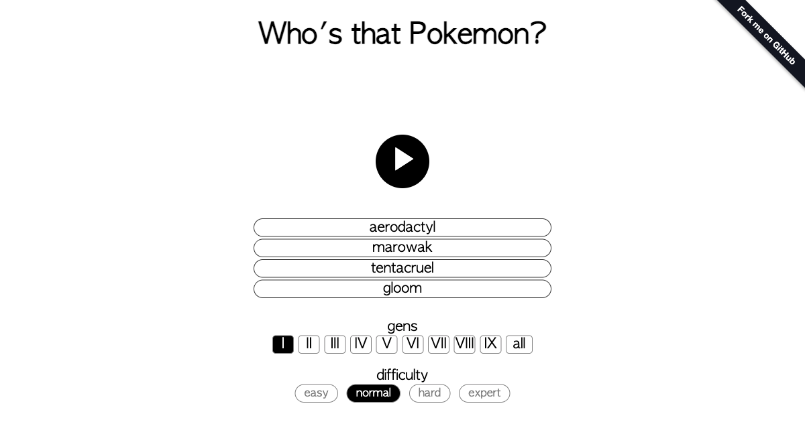

# pokecry

Pokecry is a simple web game in which you can try guessing Who's That Pokemon based on their cry from the games.



Motivation from this came from me and my cousins playing Pokemon games growing up. Whenever we encountered a wild pokemon and heard its cry, the other would often guess which Pokemon it was.

## Development

Requires Node.js 22.13 or newer.

```sh
npm install
npm test
npm run build
open dist/index.html
```

`npm run check` runs the format check, lint, and type checks together.
`npm run test:coverage` runs the tests and writes an lcov report to `coverage/`.

`npm run typecheck` checks the TypeScript without emitting files. `npm run lint`
checks with ESLint, and `npm run lint:fix` applies its fixes. `npm run format`
formats with Prettier, and `npm run format:check` verifies formatting without
writing.

CI runs on pull requests and pushes to `main`, covering the checks, tests, and a
production build. Coverage is uploaded to Codecov from CI.

## Deployment

Pushes to `main` are checked, tested, built, and deployed as a GitHub Pages
artifact.

## Credits

Pokemon data, sprites, and cries are sourced from [PokeAPI](https://pokeapi.co/), the [PokeAPI sprites repository](https://github.com/PokeAPI/sprites), and the [PokeAPI cries repository](https://github.com/PokeAPI/cries).

Pokemon is a trademark of Nintendo, Creatures Inc., and GAME FREAK inc. This is an unofficial fan project and is not affiliated with or endorsed by them.

## License

[MIT](LICENSE)
