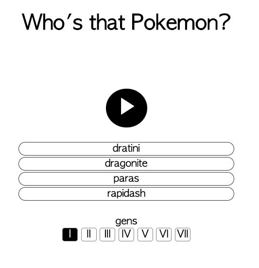

# pokecry

Pokecry is a simple web game in which you can try guessing Who's That Pokemon based on their cry from the games.



Motivation from this came from me and my cousins playing Pokemon games growing up. Whenever we encountered a wild pokemon and heard its cry, the other would often guess which Pokemon it was.

## Development

Requires Node.js 22 or newer.

```sh
npm install
npm run build
open dist/index.html
```

`npm run typecheck` checks the TypeScript without emitting files.

## Deployment

Pushes to `main` are built by GitHub Actions and deployed as a GitHub Pages
artifact.
